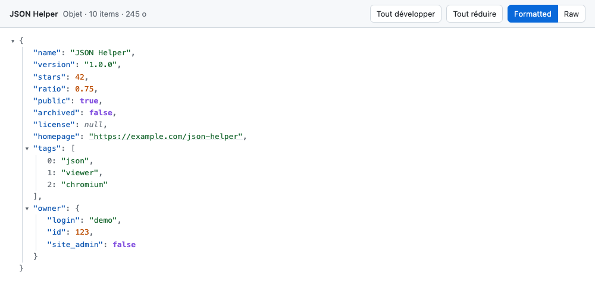

# JSON Helper

Extension pour navigateurs Chromium (Chrome, Brave, Edge…) qui affiche les réponses JSON brutes sous forme d'**arborescence colorée et pliable**.

- **Léger :** 3 fichiers, JavaScript vanilla, aucune dépendance.
- **Privé :** traitement 100 % local. L'extension ne fait **aucune requête réseau** et ne demande **aucune permission**.
- **Fidèle au texte source :** l'ordre des clés est conservé, les grands entiers (IDs 64 bits) ne sont pas arrondis et les clés dupliquées restent visibles.



---

## Sommaire

1. [Fonctionnalités](#fonctionnalités)
2. [Installation manuelle (pas à pas)](#installation-manuelle-pas-à-pas)
3. [Vérifier que ça marche](#vérifier-que-ça-marche)
4. [Utilisation](#utilisation)
5. [Mettre à jour / désinstaller](#mettre-à-jour--désinstaller)
6. [Dépannage](#dépannage)
7. [Limites connues](#limites-connues)
8. [Développement](#développement)

---

## Fonctionnalités

| Fonction | Détail |
|---|---|
| Détection automatique | Header `Content-Type` JSON (`application/json`, `text/json`, `application/*+json`…) **ou** page dont le contenu brut est un objet/tableau JSON valide. |
| Coloration syntaxique | Clés, chaînes, nombres, booléens et `null` ont chacun leur couleur. |
| Arborescence pliable | Flèche ▾/▸ devant chaque objet et tableau. Un bloc replié affiche `{… 12 items}`. **Alt+clic** plie ou déplie récursivement. |
| Chemin et copie | Un clic sur une ligne affiche son chemin en bas de page (`data.items[3].id`, ou `.data.items[3].id` en notation jq). **Copier le chemin** ou **Copier la valeur** (objet/tableau en JSON indenté et fidèle à la source, chaîne sans guillemets). |
| Barre d'outils | **Tout développer**, **Tout réduire** et bascule **Formatted / Raw** pour revenir au texte brut d'origine. |
| Thème | Clair ou sombre, selon le réglage du système. |
| Gros fichiers | Au-delà de **2 Mo**, la vue brute s'affiche par défaut avec un bouton « Afficher l'arborescence quand même ». |
| Liens | Les URL `http(s)://` contenues dans les chaînes sont cliquables et s'ouvrent dans un nouvel onglet. |
| Divers | Index des tableaux affichés, BOM UTF‑8 et préfixes anti‑XSSI (`)]}',`) ignorés, navigation au clavier (Tab, puis Entrée ou Espace sur une flèche). |

---

## Installation manuelle (pas à pas)

> **Durée :** 2 minutes. Pas besoin de compte ni de Web Store.

### Étape 1 : récupérer les fichiers

Au choix :

- **Depuis le zip :** décompressez `json-helper-1.1.0.zip`. Si vous ne l'avez pas, générez-le avec `./scripts/package.sh` (voir [Développement](#développement)).
- **Depuis le dépôt :** utilisez directement le dossier du projet (celui qui contient `manifest.json`).

> ⚠️ **Placez le dossier dans un emplacement durable**, par exemple `~/Applications/json-helper/` ou `C:\Outils\json-helper\`.
> Le navigateur charge l'extension **depuis ce dossier à chaque démarrage** : s'il est supprimé ou déplacé (dossier Téléchargements vidé…), l'extension disparaît.

### Étape 2 : ouvrir la page des extensions

Tapez dans la barre d'adresse :

| Navigateur | Adresse |
|---|---|
| Google Chrome | `chrome://extensions` |
| Brave | `brave://extensions` |
| Microsoft Edge | `edge://extensions` |
| Chromium, Vivaldi, Opera… | `chrome://extensions` (redirigé automatiquement) |

### Étape 3 : activer le mode développeur

- **Chrome / Brave :** interrupteur **Mode développeur** en haut à droite.
- **Edge :** interrupteur **Mode développeur** dans le panneau de gauche.

### Étape 4 : charger l'extension

1. Cliquez sur **Charger l'extension non empaquetée** (*Load unpacked*).
2. Sélectionnez **le dossier qui contient `manifest.json`** : sélectionnez le dossier lui-même, pas un fichier qu'il contient.
3. La carte **JSON Helper 1.1.0** apparaît avec l'icône `{ }`.

### Étape 5 (optionnelle mais recommandée) : fichiers locaux

Pour formater aussi les fichiers `.json` ouverts depuis le disque (`file://…`) :

1. Sur la carte de l'extension, cliquez sur **Détails**.
2. Activez **Autoriser l'accès aux URL de fichiers**.

### Étape 6 (optionnelle) : désactiver un autre visualiseur JSON

Si une autre extension JSON est installée, désactivez-la pour éviter que les deux se disputent la page.

---

## Vérifier que ça marche

1. Ouvrez une API publique, par exemple <https://api.github.com/repos/nodejs/node>.
2. Vous devez voir la barre **JSON Helper** en haut de la page et l'arborescence colorée.
3. Cliquez sur **Raw** : le texte brut d'origine réapparaît. Cliquez sur **Formatted** pour revenir à l'arbre.

Si rien ne change, voir [Dépannage](#dépannage).

---

## Utilisation

| Action | Effet |
|---|---|
| Clic sur ▾ / ▸ ou sur `… n items` | Plie / déplie le bloc |
| **Alt + clic** sur ▾ / ▸ | Plie / déplie le bloc **et tous ses descendants** |
| **Tout développer** | Déplie tout l'arbre (par paquets, sans figer l'onglet) |
| **Tout réduire** | Replie tout sauf la racine |
| **Formatted / Raw** | Bascule entre l'arbre et le texte brut d'origine |
| Tab puis Entrée / Espace | Navigation au clavier sur les flèches |
| Clic sur une ligne | Sélectionne la valeur et affiche son chemin dans la barre du bas |
| **JS / jq** | Choisit la notation du chemin : `headers["content-type"]` ou `.headers["content-type"]` |
| **Copier le chemin** / **Copier la valeur** | Copie dans le presse-papiers. La valeur garde l'ordre des clés et le texte exact des nombres. |
| Échap | Annule la sélection |

À l'ouverture, tout est déplié si le JSON fait moins de 300 Ko. Au-delà, seuls les 2 premiers niveaux le sont.

Le texte reste sélectionnable et copiable : un glisser-sélectionner ne change pas la ligne sélectionnée. Les index de tableau et les compteurs `… n items` sont exclus de la sélection.

---

## Mettre à jour / désinstaller

**Mettre à jour :**
1. Remplacez le contenu du dossier d'installation par la nouvelle version, au même emplacement.
2. Sur la page des extensions, cliquez sur l'icône **↻ (Recharger)** de la carte JSON Helper.
3. Rechargez les onglets JSON déjà ouverts.

**Désinstaller :** cliquez sur **Supprimer** sur la carte de l'extension, puis supprimez le dossier si vous le souhaitez.

---

## Dépannage

| Symptôme | Cause probable / solution |
|---|---|
| Les fichiers `.json` locaux ne sont pas formatés | Activez **Autoriser l'accès aux URL de fichiers** (étape 5). |
| Rien ne se passe sur une URL JSON | Rechargez l'onglet (les onglets ouverts avant l'installation ne sont pas concernés). Vérifiez que l'extension est **activée**. |
| Le JSON s'affiche en brut sans arborescence | Le JSON est peut-être **invalide** : par choix, l'extension ne touche alors pas à la page. Vérifiez aussi qu'il ne dépasse pas 2 Mo, auquel cas cliquez sur « Afficher l'arborescence quand même ». |
| Deux interfaces se superposent, ou l'affichage est bizarre | Une autre extension JSON est active : désactivez-la. |
| Le bouton « Charger l'extension non empaquetée » est absent ou grisé | Le **Mode développeur** n'est pas activé, ou il est bloqué par une stratégie d'entreprise (voir `chrome://policy`). Dans ce cas, contactez votre service informatique. |
| Message « Le fichier manifeste est manquant ou illisible » | Vous avez sélectionné le mauvais dossier : choisissez celui qui contient directement `manifest.json`. |
| L'extension a disparu après un redémarrage | Le dossier d'installation a été supprimé ou déplacé. Remettez-le en place et rechargez l'extension. |
| Chrome affiche « Désactiver les extensions en mode développeur » | Message normal pour une extension non empaquetée : choisissez **Conserver** (ou fermez la bulle). |
| Brave : rien ne s'affiche | Les Shields de Brave ne bloquent pas l'extension. Vérifiez qu'elle est activée sur `brave://extensions` et, pour les fichiers locaux, l'étape 5. |

---

## Limites connues

- **Fichiers multi-documents :** NDJSON / JSON Lines (un JSON par ligne) n'est pas du JSON valide et n'est donc pas formaté.
- **Seuil des 2 Mo :** il est mesuré en caractères, ce qui est approximatif pour les textes non ASCII.
- **« Tout développer » sur un très gros fichier :** l'opération reste fluide mais peut prendre plusieurs secondes, car tout l'arbre est créé.
- **Nombres :** affichés tels qu'écrits dans la source, sans reformatage. `1.0` reste `1.0`, `1e3` reste `1e3`.
- **Pages concernées :** seule la page principale est traitée. Le JSON affiché dans une iframe ne l'est pas.

---

## Développement

### Structure

```
manifest.json          Déclaration MV3 (aucune permission)
content.js             Détection, parseur fidèle, rendu, barre d'outils, chemin et copie
styles.css             Thèmes clair/sombre, coloration (sélecteurs préfixés .jh-)
icons/                 Icônes 16/48/128 (générées par scripts/make-icons.js)
scripts/
  package.sh           Crée dist/json-helper-<version>.zip
  make-icons.js        Régénère les icônes (Node, zéro dépendance)
  make-large-fixture.js  Génère test/fixtures/large.json (~5 Mo, non versionné)
test/
  core.test.js         Tests unitaires (node --test)
  recette.md           Checklist de recette manuelle
  fixtures/            Fichiers JSON de test (cas limites, XSS, unicode…)
docs/
  cahier-des-charges.md
```

### Prérequis

Aucun pour utiliser l'extension. Pour le développement : **Node.js 18+** (tests et scripts), `zip` (packaging, présent par défaut sur macOS et Linux).

### Commandes

```sh
node --test test/                    # tests unitaires
node scripts/make-large-fixture.js   # fixture > 2 Mo pour la recette
node scripts/make-icons.js           # régénère les icônes
./scripts/package.sh                 # crée le zip distribuable dans dist/
```

### Boucle de développement

1. Modifiez `content.js` ou `styles.css`.
2. Sur `chrome://extensions`, cliquez sur **↻** sur la carte de l'extension.
3. Rechargez l'onglet de test. Les fixtures se servent par exemple avec `cd test/fixtures && python3 -m http.server 8000`, puis s'ouvrent sur <http://localhost:8000/simple.json>.
4. Déroulez [`test/recette.md`](test/recette.md) avant chaque nouvelle version.

### Choix techniques

- **Détection :** une content script n'a pas accès aux headers HTTP. Le `Content-Type` est donc lu via `document.contentType`. Sur une page HTML normale, le script s'arrête avant tout parsing : coût quasi nul.
- **Parseur fidèle :** `JSON.parse` valide le document (rapide et de référence). Un petit parseur maison construit ensuite l'arbre affiché, pour conserver l'ordre des clés, le texte exact des nombres et les clés dupliquées.
- **Sécurité :** le DOM est construit uniquement via `textContent`, jamais `innerHTML`, donc aucune injection possible depuis le contenu JSON. Seules les URL `http(s)` deviennent des liens (`rel="noopener noreferrer"`).
- **Performance :** les enfants d'un nœud replié ne sont créés qu'à sa première ouverture. « Tout développer » travaille par paquets (`requestAnimationFrame`). Un seul écouteur d'événements est posé par zone.
- **Isolation CSS :** `styles.css` est injecté sur toutes les pages par le manifest. Chaque sélecteur est donc préfixé (`.jh-*`, `html.jh-active`) pour n'avoir aucun effet ailleurs.

### Publier une nouvelle version

1. Incrémentez `version` dans `manifest.json`.
2. Ajoutez une section `## X.Y.Z — AAAA-MM-JJ` dans `CHANGELOG.md`.
3. Lancez `node --test test/` et déroulez la recette.
4. Commitez, puis créez et poussez l'étiquette :
   ```sh
   git tag vX.Y.Z
   git push origin main vX.Y.Z
   ```

Le push de l'étiquette déclenche le workflow [`release.yml`](.github/workflows/release.yml). Il relance les tests, vérifie que l'étiquette correspond à la version du manifest, construit le zip avec `scripts/package.sh` et publie une release GitHub. Le zip y est joint et la section du CHANGELOG sert de notes de version.

Pour publier une étiquette déjà poussée : onglet **Actions** › **Release** › **Run workflow**, en indiquant l'étiquette (ex. `v1.1.0`).

En local, `./scripts/package.sh` reste utilisable pour tester le zip.

---

Licence : [MIT](LICENSE).
